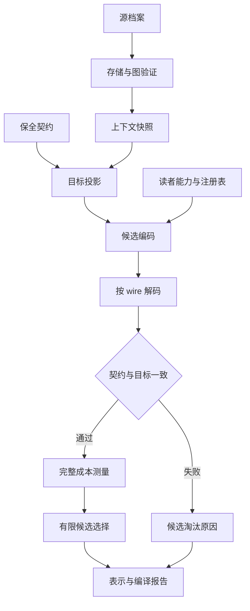

# AOCX 上下文编译架构

本文说明 AOCX 如何把档案编译为满足保全契约的紧凑表示，以及实现者如何扩展编码器、验证器和读者能力。数据字段以[核心规范](specification.md)为准，执行入口为 [`scripts/aocx.py`](../scripts/aocx.py)，验证方法见[检查与评估](validation.md)。

## 目录

1. 编译对象与优化问题
2. 编译管线与模块边界
3. 保全、来源与恢复
4. 逻辑表达与编码扩展
5. 兼容与验证

## 1. 编译对象与优化问题

输入档案包含记录图、当前修订、领域声明和资源。编译器先从档案构造上下文快照 \(P\)。快照是有限 JSON 值，字段为 `namespace`、`records`、`relations`、`heads`、`profiles`、`required_profiles` 和 `metadata`。附件与导入原件保留在档案存储层。

保全契约 \(K\) 决定目标值 \(T_{K}(P)\)。`exact` 取整个快照；`projection` 按显式选择及省略项构造目标。选择从指定对象当前修订开始，沿条件引用、`depends_on`、`assumes`、`cites` 计算闭包。这个步骤先固定需要交付的信息，编码阶段共用同一个目标。

表示封装 \(E\) 是包含目标、契约、源绑定及恢复摘要的 JSON 对象。设 \(I\) 为本次请求的有限 codec 集合，\(f_{i}\) 和 \(d_{i}\) 分别为 codec \(i\) 的编码器与解码器。每个编码器把 \(E\) 映射为完整传输字节串 \(W_{i}\)：

\[
W_{i}=f_{i}(E).
\]

设 \(R\subseteq I\) 为接收方支持且本地已实现的候选。可接受集合 \(A\) 包含其中能够完成解码、且解码封装与 \(E\) 类型和值一致的候选。编译器还重新检查解码后的契约、源绑定和目标摘要。逻辑结构、固定修订、条件与保护字段的保全属于这一步的硬条件。

\[
A=\{i\in R\mid d_{i}(W_{i})=E\}.
\]

成本函数 \(C\) 计算完整 \(W_{i}\) 的 UTF-8 字节数、Unicode 字符数，或指定 tokenizer 返回的 token 序列长度。通过验收后，编译器求有限集合中的最小值：

\[
i^{*}\in\operatorname*{argmin}_{i\in A}C(W_{i}).
\]

同成本候选继续按传输字节数、codec ID 排序，结果与注册顺序无关。报告包含本次集合、各候选验收结果、成本、来源和选中的表示。这个最优性结论适用于已枚举候选和所用度量。

语义保全在机器契约中对应声明范围内的上下文值及其结构。领域命题的真值、自然语言改写质量和读者任务表现分别由领域检查与评估证据确定。逻辑优先于多语缩写，在实现中表现为先验收保全、后比较长度：多语言词汇和缩写可参与表示，候选仍须恢复相同目标值。

## 2. 编译管线与模块边界

编译采用单次加载、固定目标、逐候选验收的流程。存储层先验证资源摘要和记录图。合同层构造目标，编码层生成 wire，解码端通过 wire 首行在同一注册表中选择实际 decoder。候选的失败信息进入报告，其余候选继续处理。

| 模块 | 输入与输出 | 负责的状态与边界 |
| --- | --- | --- |
| `common.py` | JSON、路径和错误数据 → 规范化值、摘要或结构化错误 | 共享严格 JSON 和基础工具 |
| `model.py` | 记录、关系 → 校验索引与 `GraphIndex` | 修订身份、关系解析、条件和依赖闭包 |
| `storage.py` | 目录或 ZIP → 已校验档案；记录 → 新档案 | 资产清单、路径、摘要和存储边界 |
| `contracts.py` | 已校验档案与契约 → 快照、目标和源绑定 | `exact` / `projection` 的共同保全语义 |
| `codecs.py` | 完整封装 ↔ 传输字节 | codec 身份、注册表、可逆语法与资源上限 |
| `optimizer.py` | 源档案、契约、候选与度量 → 表示和报告 | 候选准入、往返验证、完整成本与确定性选择 |
| `logic.py` | 显式表达式 ↔ 开放 AST | 结构检查、Unicode 标识、未知节点的保留 |
| `legacy.py`、`adapters/` | 原始 AOCI / GBCX → 档案与投影 | 原件保留、来源与格式映射 |
| `views.py` | 档案 → 兼容 capsule；语言视图 → 检查报告 | 共享选择与保护契约，语言评估绑定 |
| `negotiation.py` | 能力声明或三个快照 → 协商、冲突报告 | 共同能力与版本分叉 |
| `cli.py`、`aocx.py` | 命令参数或历史 API 调用 → 操作结果 | CLI 编排与既有调用兼容 |

核心各层使用 Python 标准库；CLI 的 token 度量按需使用 `tiktoken`。Python API 接收 tokenizer 回调及其标识。注册的插件是宿主明确提供的 Python 代码，编码文本中的构造符和词典引用仅作为数据解析。

## 3. 保全、来源与恢复

`source.snapshot_sha256` 绑定完整源上下文值，包括 `heads`、profile 与元数据；`records_sha256`、`relations_sha256` 绑定原 JSONL 字节。这样，当前修订变化、元数据变化和源文件重新序列化都有各自可核对的证据。

`recovery.target_sha256` 绑定目标上下文。`decode` 在本地恢复并检查表示内的目标，`verify` 加载指定源档案、重建契约目标，再检查逐值一致和全部源绑定。投影中的历史前提仍使用其原 `rev`；只有实际源 head 已被保留的对象才出现在投影 `heads` 中。

上下文值恢复与原件字节恢复有不同的输入输出。前者从 `.aocx` 表示得到 JSON 对象；后者从保存原件的档案执行 `restore`，得到原 ZIP 或原目录文件。表示内的 `metadata` 保存除容器字段外的 manifest 值；`assets`、`origins` 和记录文件路径由档案容器负责。

失败按边界定位：源档案错误终止目标构造；单个候选的 decoder 缺失、wire 身份错误、往返不一致或读者能力不足记录在该候选中；全部候选被淘汰时返回 `no_eligible_representation`。CLI 使用新输出路径，保留输入供复核和重新编译。

## 4. 逻辑表达与编码扩展

自由文本和显式逻辑结构共同进入快照。`logic.py` 为作者已经声明的 `aocx-logic/1` 结构提供 AST 校验、解析与渲染；谓词、函数、变量和领域规则保持开放。已知节点使用紧凑符号，未知节点或附加字段通过 `AST(JSON)` 保留。核心只给显式结构赋予这些节点含义。

`aocx-expr/1` 把常见封装、记录、关系和引用写为命名构造符，并通过 `Logic(expression_string, extra)` 保存可解析回开放 AST 的显式逻辑。`aocx-expr-dict/1` 在完整 wire 中附带共享字符串词典，用索引复用重复字符串。词典定义本身进入成本测量。`json/1` 使用同一封装的严格 JSON 表示，提供可显式比较的基线。

扩展编码器实现 `Codec(id, encode, decode)`，经 `CodecRegistry.register` 注册。编码函数得到独立的封装副本，返回带准确 codec 首行的 `bytes`；解码函数返回完整封装。宿主通过 API 传入注册表和候选 ID，收发两端使用同一 codec 契约。候选中的任意缩写、词典化或结构变换最终都按同一解码目标验收。

解码器同时约束 wire 体积、嵌套深度、节点数和展开字符串体积。展开字符串累计上限为 64 MiB，覆盖词典的每次引用、生成的结构字段及解析后的逻辑 AST；表达式原文也进入计数。具体额度与统计口径见[实现边界](specification.md#10-兼容接口与实现边界)。

## 5. 兼容与验证

`compile` / `optimize`、`decode`、`verify` 是新表示的主工作流。旧 `capsule` / `parse_capsule` 保留 `table-jsonl/1` 的头部和行协议，内部复用保全与选择规则。AOCI/GBCX 的输入映射、原件恢复、能力协商与三方冲突检查继续作为独立模块提供。

BabelTele 视图采用读者与任务绑定的评估路径。结构检查报告、证据绑定和实际语义评估分别留有状态；压缩正文、任务、读者或来源发生变化时，已有评估绑定随之变化。

验收按[验证规范](validation.md)执行：精确模式往返整个上下文；投影模式覆盖闭包、字段省略与历史修订；失真编码器、源绑定漂移、未知扩展和 decoder 身份错误进入反例测试。当前测试运行与成本结果记录在对应执行证据中，历史记录保留原样本和原执行范围。
